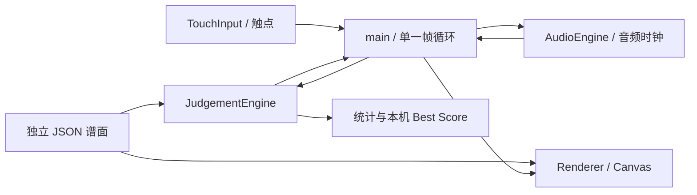

# Musical Game — 技术方案

> 持续维护文档。当前版本：0.2；最后核对：2026-10-13（日本时间）。
> 本文描述 `/Users/corachen/Documents/ChatGPT/musical` 的实际代码。历史产品资料中的其它目录不是本工程的维护位置。

## 1. 当前状态与完成边界

目标是验证「用手指演奏 Vocal Performance」：歌词就是可操作音符，时间决定触碰时机，纵向位置表达音高，持续轨迹表达时值和音高变化。

| 内容 | 当前状态 |
| --- | --- |
| 手机横屏 Web、剧场视觉、竖屏提示 | 已实现 |
| 歌词 Tap / Hold / Trace、连续 MIDI 音高映射 | 已实现 |
| 操作开关合成旋律、持续合成伴奏 | 已实现 |
| 入口、暂停/继续、结算、Retry / Back | 已实现 |
| 本机 Best Score | 已实现 |
| 《Satisfied》原曲人声与伴奏 | 尚未接入 |
| “I remember that night…” 到 “…this is not a game.” 的准确谱面 | 尚未制作与校对 |
| iPhone Safari 真机延迟、触感、音乐反馈验证 | 待验证 |

当前试玩为 **26 秒、19 个音符、原创短句与合成音色**，不是《Satisfied》的音乐转录或原唱。首页的剧目名称用于表达产品方向。已经具备 P0/P1 的演示实现，但没有证明真实人声的体验成立，也未完成 P2 和完整 V0 验收。

## 2. 技术选择与约束

| 技术 | 用途与选择理由 |
| --- | --- |
| TypeScript | 明确谱面、触点、判定状态接口，降低频繁迭代时的耦合 |
| Vite | 本地预览与静态构建，不引入游戏引擎 |
| Canvas 2D | 绘制连续音高曲线、歌词及逐帧时间位置 |
| Web Audio / AudioContext | 统一音乐时钟、合成声部与音量包络 |
| Pointer Events | 同一接口处理触屏、多指及鼠标辅助检查 |
| HTML / CSS | 入口、横屏 HUD、暂停、结算和剧场背景 |
| localStorage | 仅保存本机最佳成绩；失败不阻断流程 |
| Vitest | 判定、音频生命周期、触控及方向控制的回归验证 |
| Sites 静态托管 | 对外发布，无游戏后端 |

依赖范围以 `package.json` 为准：TypeScript `^5.9.3`、Vite `^7.1.0`、Vitest `^3.2.0`；实际安装版本以 `pnpm-lock.yaml` 为准。运行环境要求 Node 20.19+ 或 22.12+。不包含账号、麦克风、AI 自动谱面、排行榜、数据库或服务端成绩。

## 3. 模块与数据流



| 文件 | 职责 / 主要接口 |
| --- | --- |
| `src/main.ts` | 页面状态与模块协调；启动、单一 RAF 循环、暂停、恢复、结束 |
| `src/demo-chart.json` | 纯谱面数据，不存放判定逻辑 |
| `src/chart.ts` | `VocalNote` 类型、`pitchAt(note, elapsed)` 曲线插值 |
| `src/config.ts` | 集中可调的音乐与判定参数 |
| `src/audio.ts` | `Transport` 与 `AudioEngine`；`start/time/pause/resume/stop`、`tap/setVoice` |
| `src/rendering.ts` | `PitchMapping`、`Renderer.draw`、`pitchFromY`；绘制与触控共享音高换算 |
| `src/touch.ts` | `contacts/clear`；捕获指针、缓冲极短点击、取消与多指处理 |
| `src/judgement.ts` | 音符认领、覆盖率、判定与统计；`update/reset/releaseOwners/results` |
| `src/lifecycle.ts` | `TransitionGuard`：使失效的异步启动/恢复不能提交页面状态 |
| `src/orientation.ts` | `requiresRotation(width, height)`：手机竖屏进入旋转提示 |
| `src/results.ts` | `saveBest`：容错读取/写入本机最佳成绩 |
| `src/style.css` | 横屏舞台布局、方向提示、安全区与装饰层 |

每帧按以下顺序执行：读取音频时间 → 获取触点 → 更新判定 → 触发短音/更新持续声部开门 → 绘制 → 更新 HUD → 判断片段结束。绘制时间与判定时间都来自音频时钟，不使用独立累加的动画时间。

## 4. 谱面契约

```ts
interface VocalNote {
  id: string;
  startTime: number;  // 相对游戏音乐起点的秒数
  duration: number;   // 秒
  pitch: number;     // MIDI 音高，可包含小数
  lyric: string;
  pitchCurve?: { time: number; pitch: number }[];
}
```

`pitchCurve.time` 是相对音符开始的秒数，点之间线性插值，曲线范围外取首/尾点音高。没有曲线时取固定 `pitch`。视觉使用每个音符的真实音高位置，不归并成四轨或 Low/Mid/High。

制作数据时必须保证 id 唯一、时间非负、duration 为正、曲线时间严格递增，并按演唱顺序排列。当前为代码随包加载的内部 JSON，**尚无外部谱面导入或运行时校验器**；未来导入前需要实现这些校验。建议曲线首点时间为 0，首点音高与 `pitch` 一致。

## 5. 时间、音高与横屏布局

- 音高向上递增；触点的纵向坐标通过绘制所用的同一个 `PitchMapping` 转回 MIDI 音高。
- 时间从右向左滚动；判定线当前在画布宽度的 **23%**，预览时间为 **3.6 秒**。
- `x = 判定线位置 + (音符时间 − 当前时间) × (画布宽度 − 判定线位置) / lookAhead`。
- `y = bottom − (pitch − pitchMin) / (pitchMax − pitchMin) × (bottom − top)`。
- 画布高度小于 350px 时上下各保留 28px；其它高度使用顶部 44px、底部 54px。DPR 上限为 3，逻辑坐标保持 CSS 像素。
- 手机横屏填充视口；桌面舞台框约为 2.16:1。已检查 844×390、667×375 的浏览器视口。
- 宽度小于 900px 且高大于宽时提示旋转；正在演奏时自动暂停，回到横屏后主动继续。没有依赖强制锁定屏幕方向。
- 背景为 `public/stage-backdrop.png` 的原创生成素材；歌词和判定线绘制在其上，装饰不参与判定。

目前水平触碰坐标不限制命中：玩家在游戏区的对应高度触碰即可。是用于 P0 的宽容方案，不能描述为「必须精确点中判定线上的字」。

## 6. 交互与判定算法

音符状态为 `pending → active → done`，每个音符只结算一次。触点通过 `pointerId` 跟踪，开始时间由音频时钟记录。

### Tap

`duration < 0.3s` 使用短音逻辑。必须是尚未使用的新触碰，按下时间与音符开始时间相差不超过 Good 窗口，接触高度在音高容错内，并在按下后 0.1s 内被帧循环消费。首次匹配后立即结算，成功时触发一个短合成声部；不要求持续按住。

### Hold / Trace

其余音符进入持续逻辑。Hold 用固定音高；Trace 用 `pitchAt` 的当前曲线音高。有效触点存在且音高在容错内时 gate 开启，才累计覆盖时间；松手或偏离即关闭声音。到音符尾端按覆盖比例与起始时间误差结算。

暂停/尺寸变化会清空触点并释放持续音的 owner，恢复时允许新的触点认领仍在进行的音符。普通松手后没有开放任意新触点补按，避免把该恢复策略当成正常连按玩法。

### 当前参数

| 参数 | 值 | 含义 |
| --- | --- | --- |
| `perfectWindow` | 0.09s | 起始误差不超过 ±90ms |
| `goodWindow` | 0.22s | 起始可认领范围 ±220ms |
| `pitchTolerance` | 1.65 | 与目标音高相差不超过 1.65 半音 |
| `holdThreshold` | 0.3s | 短音与持续音分界 |
| `perfectCoverage` | 0.87 | 持续音至少覆盖 87%，且满足 Perfect 起始窗口 |
| `goodCoverage` | 0.55 | 持续音至少覆盖 55% |
| `pitchMin / pitchMax` | 58 / 74 | 当前画布音高范围 |
| `lookAhead / duration` | 3.6s / 26s | 预览跨度 / 演示结束时间 |
| `perfectScore / goodScore` | 100 / 60 | Miss 为 0；当前满分 1900 |

没有额外的「偏离后仍算持续成功」宽限计时，当前宽容性来自音高范围和总覆盖率。每帧覆盖增量上限为 0.05s，防止卡顿后一次性补出大量成功时长，但低于约 20FPS 时会低估覆盖率；需要实际 Playtest 后决定调整方式。

除了 `config.ts`，0.1s 触碰消费时限、0.05s 增量上限、判定线比例和画布边距仍在模块中。这些是目前未完全集中配置的参数，后续调参应同步修改本文，避免误以为所有常数都已外置。

## 7. 音频与生命周期

当前伴奏由程序生成；每 30ms 检查 0.6s 节拍，合成简单和弦/音色。它不是专业前瞻调度器。演奏声部使用锯齿波、带通滤波及增益包络，MIDI 转频率为 `440 × 2^((pitch − 69) / 12)`；听到的是音高音色，不是可辨认的歌词演唱。

`AudioContext.currentTime` 驱动 `Transport`。点击 Play/Continue 后解锁或恢复音频；暂停冻结 transport，并停止、断开所有存活声源；stop 另外清除伴奏定时器和归零。声源直到 ended 前都被跟踪，避免旧短音/伴奏尾音在下一轮复活。普通 gate 关闭采用短包络淡出，生命周期停止直接断开声源。

页面状态为 `entry / playing / paused / results`。后台切换、`pagehide`、竖屏旋转触发暂停或取消待完成的异步转换。`TransitionGuard` 用代次检查和「页面可见且方向合适」条件，防止 Play/Resume 在等待音频期间被 Back、后台或旋转打断后仍进入 playing。`busy` 防止重复按钮启动，页面只保留一个动画循环。

当前没有蓝牙耳机/系统输出延迟补偿、AudioContext 意外中断检测或用户校准功能。音频时钟一致不等于实际听感延迟已经校准。

## 8. 《Satisfied》接入方案（计划，未实现）

素材说明见 [audio/satisfied/README](../public/audio/satisfied/README.md)。优先提供同一录音版本、相同起点、相同时长的人声 WAV、纯伴奏 WAV 和参考完整混音；MP3 / M4A 也可先用于核对。整首和片段均可，需说明版本及目标段落的大致起止。

推荐先采用**同步双轨 + 人声增益开门**：伴奏与人声 AudioBuffer 同时调度，人声平时静音，有效操作时打开其增益。这样迟触碰不会从词头重新播放并落后伴奏，Hold/Trace 只控制人声可听程度。暂停/恢复要以同一个片段 offset 重新创建两条 BufferSource，不能复用已经开始过的节点。

实施顺序：

1. 核对素材质量、版本、起止与分轨同步；明确人声是否含对白/合唱。
2. 解码并裁定片段，增加加载/错误/重试状态；所有音频 ready 后才允许进入游戏。
3. 在 `AudioEngine` 增加真实分轨播放模式，沿用音频时钟和 gate 接口；短词只短时打开人声窗口，连续词需处理重叠窗口。
4. 人工制作并试听校对每词/音节的 startTime、duration、pitch 与曲线；说唱段的细微音高作为待验证标注，不假称自动准确检测。
5. 更新曲长、音高范围、入口说明与按谱面区分的 Best Score key；目前部分 UI 时长文案仍写死为 26 秒，也必须替换。
6. 验证迟触碰、漏音、长音松手、重叠事件、暂停恢复与蓝牙延迟，再决定是否需要逐词切片。切片是备选方案，切换时另记决策。

只有完整混音时，无法独立控制原唱与伴奏。可以作为参考或原曲试听来源；人声分离是额外的素材处理步骤，需要检查泄漏和伪影，尚未实现。不能用混音整体静音冒充独立的人声响应。

## 9. 结果与存储

Score 为 `Perfect × 100 + Good × 60`。Miss 清零 Combo，成功增加 Combo；Max Combo 记录本轮峰值。Best Score 使用 `musical-demo-best`，只存在当前浏览器的 localStorage；存储不可用或内容非法时正常返回本轮成绩。换设备、浏览器或清除网站数据后不会保留成绩。没有用户历史成绩或服务端统计。

## 10. 开发、验证与发布

```sh
pnpm install
pnpm dev
pnpm test
pnpm build
```

本机无全局 Node 时可用 `./start.sh`，脚本查找 Codex 附带的运行时。`pnpm build` 执行 TypeScript 检查及 Vite 静态构建；产物在 `dist/`。

2026-10-13 本次文档核对重新运行 Vitest：**6 个测试文件、21 项测试全部通过**。覆盖判定和曲线、多指与极短点击、暂停后新手指认领、声源清理、时钟、方向/异步转换、音高映射、存储失败。没有本次重新执行浏览器和构建；历史构建与视口检查见 [横屏迭代记录](2026-10-11-landscape-update.md) 和 [执行记录](progress.md)。未完成真实 iPhone 的音频、性能和触控验收。

发布采用 Sites 静态托管。已记录的公开链接为 [Musical Vocal Stage](https://musical-vocal-stage.corachen1002.chatgpt.site)，部署记录在 [deployment.md](deployment.md)，站点身份在 `.openai/hosting.json`。记录证明 2026-10-11 的版本发布成功；本文核对没有重新验证线上内容或访问策略。

本地开发工程与发布源码副本 `sites/musical` **不是自动同步**。下次发布必须同步选定的游戏代码与公开素材、重新构建、通过 Sites 源码 helper 推送对应源码、打包并保存版本后部署；复用现有 project_id，不重复创建站点。检查终态成功后再宣称上线。保持源码 commit 与构建包一致，排除开发记录、凭据、node_modules 等非发布文件。源码凭据只能在当前会话通过隐藏 stdin 传递，不写入文档或仓库。

当前 GitHub remote 为 `https://github.com/Corara20001/musical.git`，这与 Sites 发布是两个独立同步动作；配置 remote 或本地 commit 不代表已成功 push。本次未检查远端分支状态。

## 11. 下一阶段与维护规则

优先级：取得素材 → 真实分轨音频与短谱面验证 → 完成目标片段 → 真机试玩与参数校准。不要为原型提前引入后台、游戏引擎或完整编辑器。

维护约定：

- 本文是当前技术方案入口；修改模块接口、谱面结构、判定、音频、发布方式时，同步修改对应章节。
- 每次更新写明核对日期；代码事实、已执行验证和计划方案分开记录。
- 设计变更追加到下面的迭代历史；历史规格、计划和部署证据保留，不覆盖为新结论。
- 更新参数表必须对照源码；无测试/真机证据的功能不标为验证完成。
- 公开发布需单独遵循发布流程；维护本文不意味着已经更新线上版本。

## 12. 迭代历史（追加）

| 日期 | 版本 / 变化 | 依据 |
| --- | --- | --- |
| 2026-10-11 | 0.1：合成声音 P0/P1，模块隔离，Tap/Hold/Trace 与完整演示流程 | 初始规格与实现；原曲素材缺失 |
| 2026-10-11 | 0.2：手机横屏、音乐剧舞台视觉、方向/异步保护、公开 Sites 发布 | 用户横屏/视觉/分享请求；详见迭代与部署记录 |
| 2026-10-13 | 汇总并建立持续技术方案，核对现有代码与 21 项测试；明确分轨接入方案及当前限制 | 用户要求维护技术文档；未改变产品代码或发布版本 |
